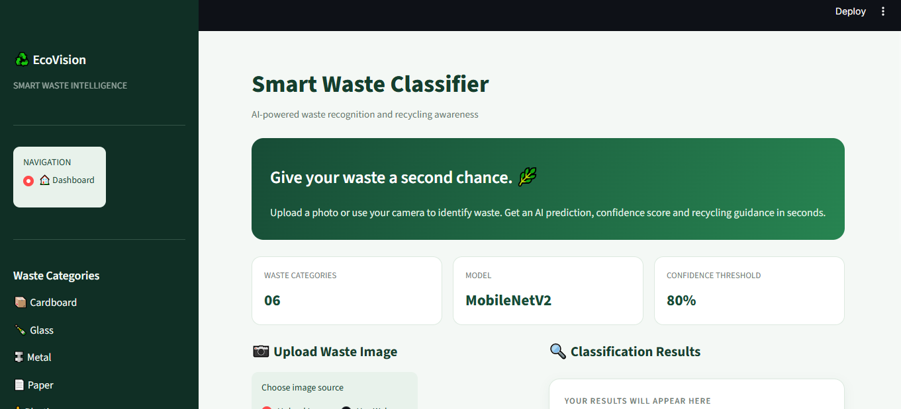
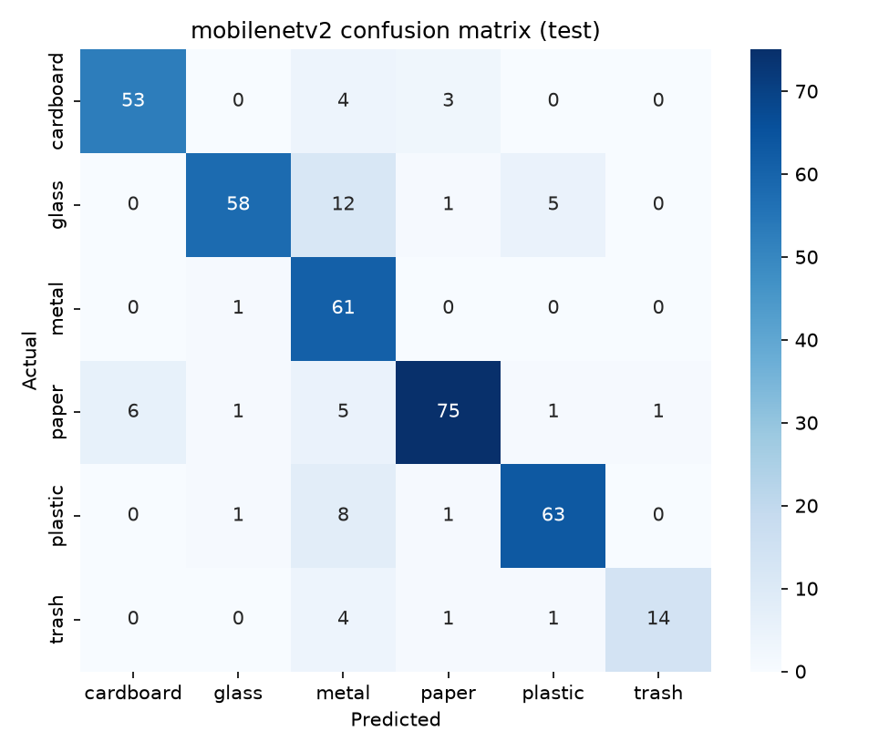
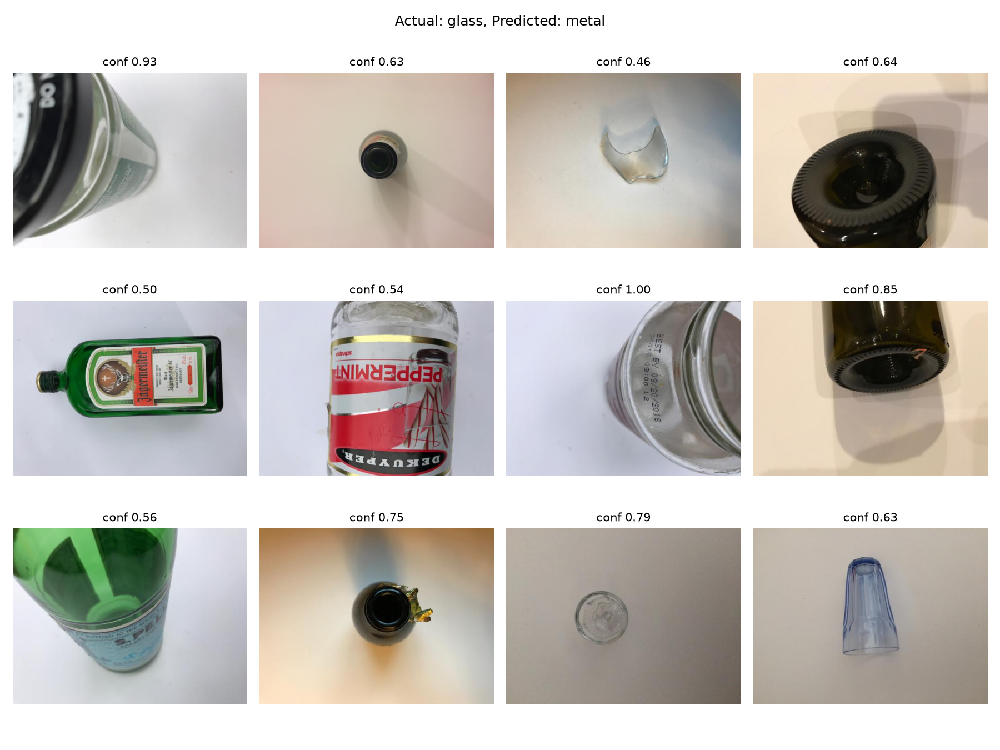
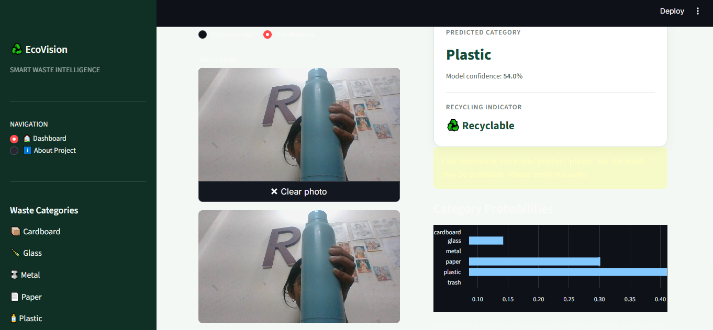
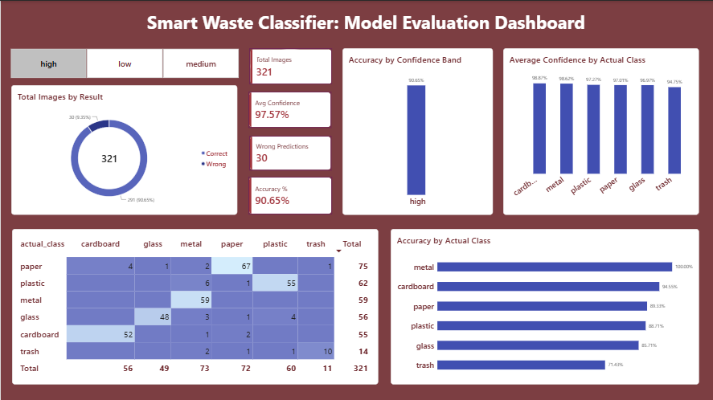

# ♻️ EcoVision: Smart Waste Classifier with Analytics

I built this project to answer a simple question: can a lightweight model look at a photo of trash and tell you what it is made of, and, just as important, can it tell you when it is _not sure_? The model sorts waste into 6 classes using transfer learning (MobileNetV2), and around it I added error analysis, SQL analytics, a Streamlit app and a Power BI dashboard.



## Project progress

- [x] Phase 1: Setup and data
- [x] Phase 2: Model training and comparison
- [x] Phase 3: Error analysis
- [x] Phase 4: SQL analytics
- [x] Phase 5: Streamlit app
- [x] Phase 6: Power BI dashboard

## About the data (TrashNet)

I used the TrashNet dataset: 2,527 photos across 6 classes (cardboard, glass, metal, paper, plastic, trash).

- The classes are not balanced. Trash has just 137 images while paper has 594, roughly 4.3x more.
- Every image is 512x384, and most are shot on a plain background.
- I split the data 70/15/15 with stratification, giving 1768 train, 379 validation and 380 test images.
- To deal with the imbalance I used class weights. Augmentation (flip, rotation, zoom, contrast, brightness) was applied to the training set only, so validation and test stay clean.

## Models I tried

| Model        | What it is                                                                                                                                    |
| ------------ | --------------------------------------------------------------------------------------------------------------------------------------------- |
| Baseline CNN | A small CNN trained from scratch, used as a reference point                                                                                   |
| MobileNetV2  | ImageNet-pretrained. Trained in two stages: first only the new head (base frozen), then fine-tuned the top 60 layers with a low learning rate |

## Results

| Model           | Split      | Accuracy  | Macro F1 |
| --------------- | ---------- | --------- | -------- |
| Baseline CNN    | Validation | 53.8%     | 0.51     |
| MobileNetV2     | Validation | 87.9%     | 0.86     |
| **MobileNetV2** | **Test**   | **85.3%** | **0.85** |

Moving from scratch-training to transfer learning took validation accuracy from about 54% to 88%. I picked the model using the validation set and ran the test set only once at the end, so the 85.3% is an honest number.



## What the model gets wrong

The biggest mistake is glass being predicted as metal (12 of 76 test images). I went through these images manually and the labels are correct, so it is the model that struggles, mainly with close-ups of bottle bases and caps and with transparent or shiny objects.

One more thing I noticed: some wrong predictions come with confidence as high as 1.00. So confidence by itself cannot be trusted as proof that a prediction is right.



## SQL analytics

I stored all predictions in a SQLite database with 3 tables: `waste_classes`, `images` and `predictions`. The SQL is standard, so it should port easily to MySQL or PostgreSQL. The queries in `database/queries.sql` cover per-class accuracy, the most common confusions, and accuracy by confidence band.

The most useful finding: when confidence is 0.8 or higher, predictions are correct 90.7% of the time (321 images). Below 0.8, only about 56% are correct (59 images). That is why the app shows a "low confidence, please check manually" warning for anything under 0.8.

## Streamlit app

Run it from the project root:

```bash
streamlit run app/app.py
```

You need `models/mobilenetv2.keras` in place. The app accepts an uploaded image or a live webcam photo (the browser will ask for camera permission). It shows the predicted category, the confidence, a recyclable / not-recyclable indicator and a probability chart for all classes. Anything below 0.8 confidence gets the "unsure" warning.

Here is the webcam mode in action. It predicted a water bottle as plastic with 54% confidence, so the low-confidence warning kicked in, which is exactly what it is meant to do:



## Out-of-distribution inputs

The model knows only 6 waste classes and has no "this is not waste" option. While testing the app, a landscape photo came out as "metal" (90% confidence) and a plush cushion as "cardboard" (100% confidence). The 0.8 threshold does not catch cases like these.

Next step: add a "not waste / other" class or build a proper out-of-distribution detector.

## Power BI dashboard

The dashboard is built on `reports/powerbi_export.csv`, exported from the SQLite database. It shows overall accuracy (85.3% with no filter applied), accuracy per class, a confusion matrix and accuracy by confidence band. A high / medium / low slicer lets you filter by confidence. The screenshot below has the **high** confidence slice selected (321 images, 90.65% accuracy). The file is at `dashboards/waste_dashboard.pbix`.



## Limitations

- Near-duplicate photos of the same object may land in both train and test (possible data leakage), so the test score could be a little optimistic.
- TrashNet uses plain backgrounds, so on cluttered real-world photos the performance is likely lower.
- The trash class has only 20 test images, so its scores are unstable.
- I checked the app's preprocessing by running the full test set through the same code path: 85.0% against 85.3% in the original evaluation, so they match. But accuracy does drop on webcam photos with messy backgrounds because of the domain shift from TrashNet's clean backgrounds.
